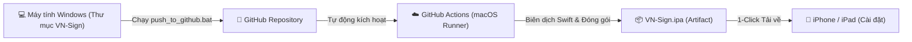

# 🚀 HƯỚNG DẪN TỰ ĐỘNG BUILD FILE VN-Sign.ipa TRÊN GITHUB ACTIONS

Tài liệu này hướng dẫn bạn cách tải mã nguồn **VN-Sign** lên GitHub để hệ thống **GitHub Actions (CI/CD)** tự động biên dịch mã nguồn và đóng gói thành tệp cài đặt **`VN-Sign.ipa`** hoàn toàn **MIỄN PHÍ**, chạy trên máy chủ Apple Mac M-Series chính chủ của GitHub mà **không cần máy tính Mac vật lý**!

---

## 🌟 Tổng Quan Quy Trình



---

## 📋 Bước 1: Chuẩn Bị & Tạo Repository Trên GitHub

1. Truy cập vào trang tạo Repository mới của GitHub: [https://github.com/new](https://github.com/new).
2. Điền các thông tin cơ bản:
   - **Repository name**: Nhập `VN-Sign` (hoặc tên bất kỳ bạn thích).
   - **Description**: `VN-Sign Native iOS Code Signing Application`.
   - **Quyền riêng tư (Visibility)**:
     - Chọn **Public** (Công khai) hoặc **Private** (Riêng tư).
     - *Lưu ý*: Cả tài khoản Public và Private đều được cấp thời lượng chạy GitHub Actions miễn phí hàng tháng.
   - **Initialize this repository with**:
     - ⚠️ **QUAN TRỌNG**: **KHÔNG** tích chọn bất kỳ ô nào (*Add a README file*, *Add .gitignore*, *Choose a license*). Giữ repository hoàn toàn trống để tránh xung đột commit.
3. Nhấp vào nút xanh **Create repository**.
4. Sau khi tạo xong, sao chép đường dẫn HTTPS của Repository (có dạng: `https://github.com/<tên-tài-khoản>/VN-Sign.git`).

---

## ⚡ Bước 2: Đẩy Mã Nguồn Lên Bằng 1 Cú Click (Khuyên Dùng)

Chúng tôi đã viết sẵn công cụ tự động hóa hoàn toàn cho bạn:

1. Mở thư mục `D:\VN-Sign` trên máy tính.
2. Nhấp đúp chuột vào tệp: **`push_to_github.bat`**.
3. Cửa sổ dòng lệnh hiện ra:
   - Nếu máy tính của bạn chưa có Git, tệp sẽ hướng dẫn bạn cài đặt (hoặc chạy lệnh `winget install Git.Git`).
   - Dán đường dẫn GitHub Repository bạn vừa sao chép ở Bước 1 vào rồi nhấn **Enter**.
   - Nhấn **Enter** để sử dụng nội dung commit mặc định.
4. Công cụ sẽ tự động:
   - Khởi tạo Git cục bộ.
   - Thiết lập nhánh `main`.
   - Thêm toàn bộ mã nguồn iOS, giao diện, cấu hình CI/CD.
   - Đẩy toàn bộ lên GitHub.

> [!TIP]
> **Dành cho lập trình viên muốn dùng lệnh thủ công qua Terminal / PowerShell:**
> ```bash
> cd D:\VN-Sign
> git init
> git branch -M main
> git remote add origin https://github.com/<tài-khoản>/VN-Sign.git
> git add -A
> git commit -m "Cập nhật VN-Sign iOS và GitHub Actions CI/CD"
> git push -u origin main
> ```

---

## ⚙️ Bước 3: Theo Dõi Quá Trình Build Tự Động

1. Mở trang Repository của bạn trên trình duyệt (ví dụ: `https://github.com/<tài-khoản>/VN-Sign`).
2. Trên thanh menu trên cùng của repository, nhấp vào tab **Actions**.
3. Bạn sẽ thấy một workflow có tên là **`Build & Package VN-Sign iOS IPA`** đang chạy:
   - Biểu tượng **màu vàng xoay tròn**: Đang khởi tạo máy Mac và biên dịch mã nguồn.
   - Thời gian build: Thông thường từ **1 đến 3 phút**.
   - Khi hoàn thành, biểu tượng sẽ chuyển sang **dấu tích XANH LÁ CÂY** (Success).

---

## 📥 Bước 4: Tải File `VN-Sign.ipa` Về Máy

Sau khi tiến trình Actions báo xanh:

1. Nhấp chuột trực tiếp vào tên lần chạy vừa hoàn tất (ví dụ: *Cập nhật VN-Sign iOS và GitHub Actions CI/CD*).
2. Bạn sẽ được chuyển đến trang tóm tắt (**Summary**).
3. Cuộn trang xuống phía dưới cùng, tìm đến mục **Artifacts**.
4. Bạn sẽ thấy tệp:
   - **`VN-Sign-ipa`** (kích thước khoảng 10MB - 15MB).
5. Nhấp chuột vào **`VN-Sign-ipa`**: Trình duyệt sẽ tải về một tệp nén zip chứa file **`VN-Sign.ipa`** nguyên bản sẵn sàng sử dụng!

> [!NOTE]
> File Artifact trên GitHub Actions được lưu trữ tự động trong **30 ngày**. Nếu bạn muốn phát hành vĩnh viễn, bạn chỉ cần tạo một Git Tag (ví dụ: `git tag v1.0.0 && git push origin v1.0.0`), hệ thống sẽ tự động tạo một mục **Release** chính thức trên GitHub và đính kèm file IPA vĩnh viễn.

---

## 📲 Bước 5: Cài Đặt File IPA Lên iPhone / iPad

Sau khi giải nén lấy được file `VN-Sign.ipa`, bạn có thể cài đặt theo các cách sau:

| Phương Thức | Yêu Cầu | Ưu Điểm |
| :--- | :--- | :--- |
| **TrollStore** | iOS 14.0 - 17.0 (tuỳ thiết bị) | Cài vĩnh viễn, không giới hạn 7 ngày, hỗ trợ đầy đủ quyền hệ thống |
| **Ký trực tiếp (E-Sign / VN-Sign)** | Chứng chỉ cá nhân / doanh nghiệp | Ký và cài ngay trên điện thoại không cần máy tính |
| **Sideloadly / AltStore** | Máy tính Windows / Mac + Cáp Lightning/Type-C | Miễn phí bằng Apple ID cá nhân (gia hạn mỗi 7 ngày) |
| **Scarlet / GBox** | Trực tiếp trên Safari | Cài đặt nhanh qua chứng chỉ cộng đồng |

---

## 🛠️ Xử Lý Lỗi Thường Gặp (Troubleshooting)

### 1. Lỗi "Authentication failed" hoặc không thể push lên GitHub
- **Nguyên nhân**: Bạn chưa đăng nhập tài khoản GitHub trong Git trên Windows.
- **Cách khắc phục**:
  - Khi cửa sổ yêu cầu đăng nhập hiện lên, chọn **Sign in with your browser** và bấm cấp quyền.
  - Hoặc tạo **Personal Access Token (PAT)** tại [GitHub Developer Settings](https://github.com/settings/tokens) (chọn scope `repo` và `workflow`) rồi dùng token làm mật khẩu.

### 2. Lỗi "Updates were rejected because the remote contains work that you do not have locally"
- **Nguyên nhân**: Lúc tạo Repo bạn lỡ tích chọn "Add README" nên remote đã có sẵn commit trước.
- **Cách khắc phục**:
  - Tệp `push_to_github.bat` sẽ tự động hỏi bạn có muốn ghi đè (Force Push) không, bạn chỉ cần nhập `Y`.
  - Hoặc chạy lệnh: `git push -u origin main --force`.

### 3. Workflow Actions bị lỗi báo quyền "Resource not accessible by integration"
- **Nguyên nhân**: Repository chưa bật quyền ghi cho GitHub Actions (Workflow permissions).
- **Cách khắc phục**:
  1. Vào repository của bạn trên GitHub -> Bấm tab **Settings**.
  2. Ở menu bên trái, chọn **Actions** -> **General**.
  3. Cuộn xuống phần **Workflow permissions**.
  4. Tích chọn **Read and write permissions**.
  5. Bấm nút **Save**.

---

## 💬 Thông Tin Liên Hệ & Hỗ Trợ

Nếu bạn cần hỗ trợ thêm về ký app, cài đặt chứng chỉ P12 hoặc tuỳ biến tính năng:

- 🎮 **Discord Hỗ Trợ**: [https://discord.gg/679mFrKtH](https://discord.gg/679mFrKtH)
- 📞 **Zalo Kỹ Thuật**: `0788843545`

*Chúc bạn trải nghiệm VN-Sign tuyệt vời!*
